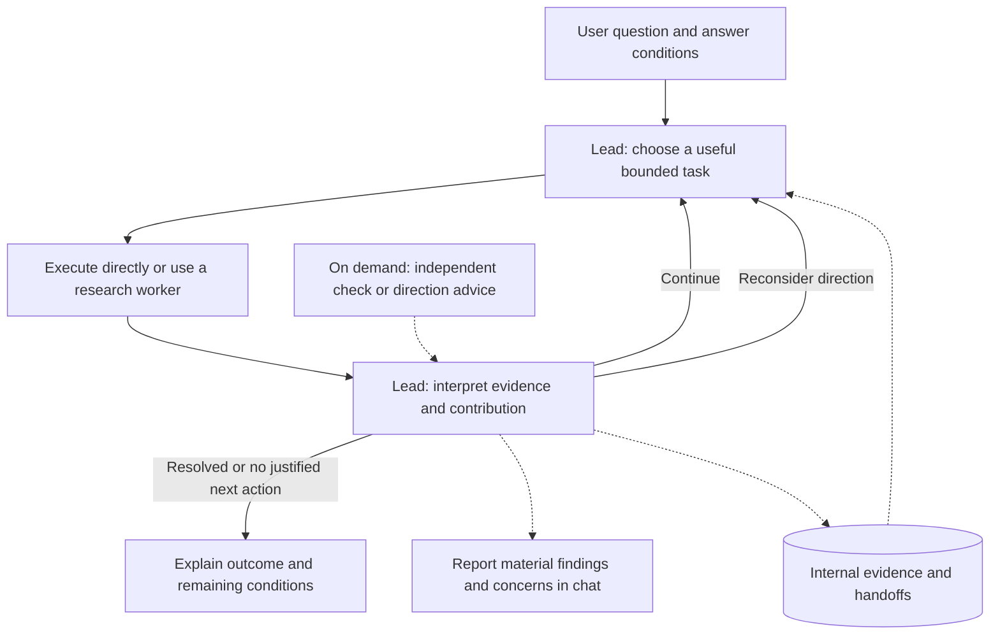

# Research Workflow 0.2.0

Use this package to advance a theoretical-physics question autonomously. Supply
the question, physical conditions, available evidence and resource constraints.
The lead returns findings, their reasoning and limits, unresolved conditions and
its next decision in chat. Durable internal records support later agents.

The [lead](../../plugins/research-workflow/skills/auto-research/SKILL.md) owns the
research cycle. A [research task](../../plugins/research-workflow/skills/researcher/SKILL.md)
executes one bounded investigation and returns evidence; it does not orchestrate
the project. [Operating details](../../plugins/research-workflow/skills/auto-research/references/workflow.md)
are an on-demand lookup. [Verification](../../plugins/research-workflow/references/verification.md)
keeps mathematical validity separate from answering the requested question.

Optional roles are [critic](../../plugins/research-workflow/skills/critic/SKILL.md),
[direction-challenger](../../plugins/research-workflow/skills/direction-challenger/SKILL.md),
[research-planner](../../plugins/research-workflow/skills/research-planner/SKILL.md),
and, for an explicit guide request,
[guide-writer](../../plugins/research-workflow/skills/guide-writer/SKILL.md).
A role is not a mandatory additional agent. Independent checks use fresh contexts
and one assigned decision perspective. They provide evidence, not admission
permission. The legacy curator is retained only for compatibility.

Prioritize whether premises apply and whether the result advances the real
question. A correct restricted theorem can remain partial progress. Check new
consequential mathematics rather than repeating unchanged checks. Exploration
need not guarantee success. Honor the user's resources and the entrypoint's
bounded-session limit; exhausting a session does not settle the scientific goal.

Chat reports include material assumptions, reasoning, verification scope,
concerns and their consequences. The human need not open internal reports.
Separate documents are created only when requested. This package does not
supply scientific truth or novelty judgments and does not automatically publish,
commit, install globally or invoke every available role.
